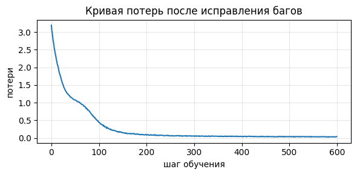

# Отчёт по ДЗ 1 «Внимание своими руками»

Как воспроизвести результаты - в [README.md](README.md). Здесь собрано, что сделано и что получилось.

## 1. Реализация четырёх функций (`dz1-attention.ipynb`)

Реализованы `split_heads`, `merge_heads`, `scaled_dot_product_attention` и `TransformerBlock.forward`. Все проверки в конце ноутбука пройдены: **17 из 17**.

| Функция | Решение |
|---|---|
| `split_heads` | Сначала `view(B, L, n_heads, d_head)`, затем `transpose(1, 2)`. Обратный порядок даёт ту же форму, но перемешивает каналы между головами. |
| `merge_heads` | `transpose(1, 2).contiguous().view(B, L, d_model)`. `contiguous()` нужен, потому что после перестановки осей тензор не непрерывен в памяти и `view` не работает. |
| `scaled_dot_product_attention` | Логиты `QKᵀ / sqrt(d_k)`, маска до softmax с подстановкой `-inf`, softmax по последней оси (по ключам), dropout на весах. |
| `TransformerBlock.forward` | Pre-norm: `x = x + attn(norm1(x))`, затем `x = x + ffn(norm2(x))`, возвращается `(x, веса внимания)`. |

### Самое неочевидное решение в TODO 3

Самым неочевидным оказался выбор оси softmax. Матрица логитов квадратная (L × L), поэтому softmax по любой из двух последних осей даёт тензор правильной формы: код не падает, и модель даже учится. Правильная ось - последняя (по ключам), потому что каждая строка должна быть распределением внимания одного запроса по позициям, на которые он смотрит. Если взять softmax по запросам (dim=-2), ломается не только нормировка строк, но и причинность: знаменатель для ключа j складывается по всем запросам i ≥ j, то есть по будущим позициям, и информация о будущих токенах протекает в прошлое в обход маски. При одной только этой ошибке падает проверка «модель не подглядывает в будущее», хотя маска применяется корректно.

## 2. Найденные ошибки (`dz1-bughunt.ipynb`, вариант seed 42)

До исправлений проходило **7 из 17** проверок, после - **17 из 17**.

| # | Функция и строка | Механизм поломки | Как исправили |
|---|---|---|---|
| 1 | `sinusoidal_positional_encoding`, строка `position = torch.arange(1, length + 1, ...)` | Отсчёт позиций сдвинут на единицу: первый токен получает код позиции 1 (`sin(w) ≠ 0`, `cos(w) ≠ 1`), каждый следующий - код соседней позиции. Кодирование перестаёт соответствовать формуле из «Attention is All You Need»: позиция 0 не кодируется вовсе, а модель получает систематически сдвинутые позиционные сигналы. Относительные сдвиги между позициями сохраняются, поэтому обучение идёт и баг не бросается в глаза, но вычисляется не то кодирование, которое заявлено, и любая модель или анализ, рассчитывающие на стандартное кодирование, получают неверные входы. | `torch.arange(length, ...)` - позиции 0…length−1. |
| 2 | `LayerNorm.forward`, строки `mean = x.mean(dim=0, ...)` и `var = x.var(dim=0, ...)` | Среднее и дисперсия считаются по оси батча, а не по признакам токена - это batch norm, а не layer norm. Вектор признаков отдельного токена не центрируется и не нормируется, его масштаб может быть каким угодно, и стабилизирующий эффект нормализации пропадает. Хуже того, выход для одного примера зависит от остальных примеров батча: один пример с большими значениями сдвигает статистики и меняет нормировку соседей. Результат модели перестаёт быть функцией только своего входа и зависит от состава и размера батча (при батче из одного примера `x − mean` вообще обнуляется). | `dim=-1`: статистики по последней оси (признакам) каждого токена отдельно. |
| 3 | `scaled_dot_product_attention`, строка `weights = torch.softmax(scores, dim=-2)` | Softmax берётся по оси запросов (столбцам), а не по оси ключей (строкам). Тогда распределением становится каждый столбец, а строка - то, с какими весами запрос i усредняет значения V, - в сумме уже не 1: выход внимания перестаёт быть взвешенным средним значений, его масштаб «плавает» от позиции к позиции. Вдобавок ломается причинность: нормировка столбца j делит на сумму по всем запросам i ≥ j, то есть вес, который ранний запрос даёт ключу j, зависит от логитов более поздних запросов - информация о будущих токенах протекает в предсказания прошлых позиций. | `dim=-1`: softmax по ключам, каждая строка весов - распределение над разрешёнными позициями. |

### Какие проверки падали и из-за чего

| Упавшая проверка | Причина |
|---|---|
| позиционное кодирование совпадает с формулой | ошибка 1 |
| нулевая позиция закодирована нулевой позицией | ошибка 1 |
| LayerNorm нормирует каждый токен отдельно | ошибка 2 |
| нормировка одного примера не зависит от остальных в батче | ошибка 2 |
| при top_k=1 генерация совпадает с argmax | ошибка 2: при генерации батч из одного примера, `x − mean` по батчу равно нулю, все логиты одинаковы, и top_k не отсекает ничего |
| генерация переводит модель в режим инференса | ошибка 2, по той же причине: при равных логитах выбор токена случаен |
| внимание совпадает с эталонной реализацией PyTorch | ошибка 3 |
| веса внимания суммируются к единице по ключам | ошибка 3 |
| масштаб логитов зависит от корня из d_k | ошибка 3 (масштаб верный, но веса нормированы по другой оси) |
| причинная маска обнуляет запрещённые позиции | ошибка 3 |

Проверка «модель не подглядывает в будущее» в исходном коде проходила, но случайно: из-за ошибки 2 выход модели при батче из одного примера не зависел от входа вообще. Если исправить ошибки 1 и 2 и оставить только ошибку 3, эта проверка падает - утечка будущего при `softmax(dim=-2)` реальна.

## 3. Обучение исправленной модели

Конфигурация: 2 слоя, 4 головы, `d_model=128`, контекст 64, dropout 0.1, AdamW с lr 3e-4, батч 32, 600 шагов, `SEED = 0`. Обучение шло на NVIDIA GeForce RTX 3050 Laptop GPU и заняло несколько секунд.



| Шаг | 0 | 100 | 200 | 300 | 400 | 500 | 599 |
|---|---|---|---|---|---|---|---|
| Потери | 3.191 | 0.441 | 0.083 | 0.048 | 0.045 | 0.042 | 0.040 |

Пример генерации (температура 0.8, top_k 10, старт с символа «а», 200 новых символов):

```
азу. алгоритм внимания смотрит на все позиции сразу. алгоритм внимания смотрит на все позиции сразу. алгоритм внимания смотрит на все позиции сразу. алгоритм внимания смотрит на все позиции сразу. алго
```

До исправления ошибок та же ячейка выдавала бессвязный набор символов из словаря корпуса.

**Почему числа не совпадают с ориентирами из условия.** Ориентиры в условии (потери 4.20 → 1.76, текст в стиле пьесы) получены на символьном корпусе из 62 символов. В ноутбуке же корпус игрушечный: одна фраза «алгоритм внимания смотрит на все позиции сразу.», повторённая 200 раз, словарь 19 символов. Стартовые потери 3.19 близки к ln(19) ≈ 2.94, то есть необученная модель раздаёт символам почти равные вероятности. Фразу легко выучить целиком, поэтому потери падают почти до нуля, а генерация воспроизводит её без искажений.
